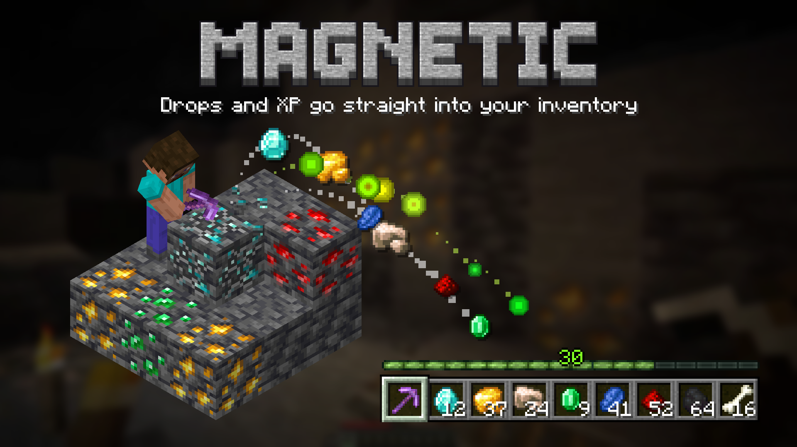

Mining above a lava lake, in a cave or in the Nether? The blocks you break and mob loot go into your inventory instead of falling into the lava and burning.

Use it as a survival enchantment, like Telekinesis from Hypixel SkyBlock, or switch it on for everyone. Works in singleplayer and on Fabric, NeoForge, and Paper servers.

## Features

- **Instant auto-pickup** of block drops, mob loot, and XP
- **No pickup radius:** only the drops you cause, never items from hoppers, farms, or other players
- **Flexible activation:** enchantment, always on, while sneaking, by permission, or a mix
- **Animated or instant:** let drops fly to you or land in your inventory right away
- **Exclusions** for blocks and entities by ID or tag
- **Bucket-aware:** collects drops caused by fluids you placed
- **Full-inventory alerts** by sound, chat message, or title

## Works with

- **Fabric and NeoForge:** [FallingTree](https://modrinth.com/mod/fallingtree), [HT's TreeChop](https://modrinth.com/mod/treechop), [KleeSlabs](https://modrinth.com/mod/kleeslabs), [RightClickHarvest](https://modrinth.com/mod/rightclickharvest), [Server Tree Feller](https://modrinth.com/mod/server-tree-feller), [Tree Harvester](https://modrinth.com/mod/tree-harvester), and [Veinminer](https://modrinth.com/mod/veinminer)
- **Paper:** [mcMMO](https://www.mcmmo.org), [AuraSkills](https://modrinth.com/plugin/auraskills), [ThizzyZ Tree Feller](https://modrinth.com/plugin/thizzyz-tree-feller), [TimberZ](https://modrinth.com/plugin/timberz), [Veinminer](https://modrinth.com/plugin/veinminer), and the [TreeCapitator](https://modrinth.com/datapack/treecapitator) datapack
- **Auto-smelt** mods, plugins, and datapacks
- **Backpacks and pickup filters** on Fabric and NeoForge, such as [Sophisticated Backpacks](https://modrinth.com/mod/sophisticated-backpacks) and [FiltPick](https://modrinth.com/mod/filtpick)

## For server owners

- **No client install on Paper**, and the plugin runs on Folia and Purpur too
- **Rank-gated** with the `magnetic.ability.use` permission
- **Live reloads** with `/magnetic reload`

## Install

| Platform | Required dependencies |
| --- | --- |
| Fabric | [Fabric API](https://modrinth.com/mod/fabric-api), [Fabric Language Kotlin](https://modrinth.com/mod/fabric-language-kotlin), [YACL](https://modrinth.com/mod/yacl) |
| NeoForge | [KotlinLangForge](https://modrinth.com/mod/kotlin-lang-forge), [YACL](https://modrinth.com/mod/yacl) |
| Paper, Folia, Purpur | None |

## Configuration

Magnetic works out of the box as an enchantment. Change it in the in-game config screen or in `magnetic.json`.

Every setting is explained in the [configuration reference](https://github.com/btwonion/magnetic/blob/master/docs/CONFIG.md).

## FAQ

### Where can I find the enchantment?

In the enchantment table, in loot, and from librarians. With the Villager Trade Rebalance experiment, look for a desert librarian.

### Why does the ender dragon's XP still drop?

The ender dragon is ignored by default. Remove it from `ignoreEntities` to collect its XP.

### How do I use Magnetic with a grave plugin on Paper?

Add `minecraft:player` to `ignoreEntities`.

### Is this the old Telekinesis mod?

Yes. It was renamed to Magnetic in version 3.2.0.

## Support

If you need help with any of my mods, just join my [discord server](https://nyon.dev/discord).
